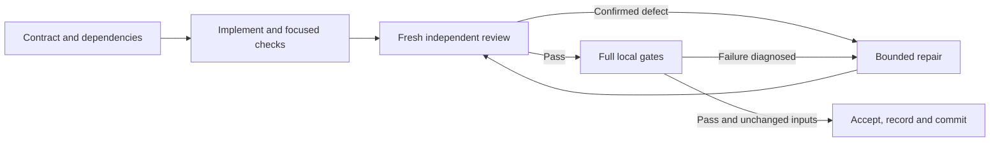

# Agentic loops for full-parity work

Planning baseline: `b39a7e3`, `feat/monster-hp-d8`, 2026-10-07. This specifies execution of the [full-parity map](2026-10-06-full-parity.md); The planning snapshot preceded implementation; execution records follow below. Keep the [existing loop constraints](2026-10-06-agentic-loops.md), P1 ledger and current user policies. Gameplay/content/command semantics remain the working target; exact C replay, original presentation and C binary files require separate scope decisions.

## Model routing and authority

Explicitly set model and reasoning effort on every delegated task. Official [OpenAI subagent guidance](https://learn.chatgpt.com/docs/agent-configuration/subagents) recommends Luna for narrow work and Sol for demanding agents, and explains inherited settings and effort tradeoffs. The assignments below are project recommendations using models available in this session, not benchmark results, prices or claims about API availability.

| Role | Model / effort | Bounded responsibility |
|---|---|---|
| Coordinator | Parent session; recommended Sol/low if selectable | Contracts, dependency queue, ledger, evidence, policy and commits; no duplicate source exploration or implementation |
| Optional explorer / inventory worker | `gpt-6-luna` / `high` | One missing fact, call-site map or at most 20 inventory rows; read-only source discovery |
| Normal implementer | `gpt-6.1-sol` / `medium` | One coherent production path and its meaningful regressions |
| Difficult implementer | `gpt-6.1-sol` / `high` | New timer/scheduling ownership, cross-level lifecycle or unresolved C ordering; choose at contract time |
| Documentation/structural reviewer | Fresh `gpt-6.1-sol` / `medium` | Check evidence and schema/call-site completeness; inventory claims need source confirmation |
| Semantic reviewer | Fresh `gpt-6.1-sol` / `high` | C branches, randomness, turn costs, lifecycle, public reachability and test strength |
| Escalation adviser | `gpt-6-astra` / `low`; optional second turn `medium` | One unresolved question after two evidenced unsuccessful repairs of the same defect |
| Verifier | Local tools; no model | NAT domain tools and commands, complete logs, hashes, exits and acceptance checks |

Use the native collaboration API with `fork_turns="none"`; supply compact context explicitly. Do not copy conversation history. Example normal worker settings: `{task_name:"p03_actor_identity", model:"gpt-6.1-sol", reasoning_effort:"medium", fork_turns:"none", message:packet}`. Reviewer gets its own thread and read-only authority. Do not change live Codex/NAT model configuration; session model names are not assumed API-backend names.

Concurrency is coordinator plus at most one active child. One source writer and one Cargo runner; no nested agents or fleet. Sequential writers/reviewers avoid shared-tree conflicts. Skip an explorer when the contract already identifies the needed symbols. Planning-only loop validation can use one Luna/high reviewer.

## The unit loop



1. **Contract:** record HEAD/branch/dirty paths and preserve unrelated edits. Pin selected C source/configuration, outcome, allowed files, prerequisites and exclusions. Define exact public behavior and independent expected state/draw/turn-cost cases. An incomplete dependency becomes a preceding unit, not hidden implementation expansion. Update `.superpowers/sdd/2026-10-04-rule-packs-p1/progress.md` before work.
2. **Implementation:** graph-first discovery; bounded current-path fallback when the graph is stale. Read only missing context. Run focused checks, record failure class and hypothesis, and hand off once owned Cargo processes exit. Worker may not edit goldens, commit, weaken assertions or alter coordinator policy/plan records.
3. **Review:** fresh reviewer receives the outcome, current diff, C references and evidence. It checks supported branches, owned definitions, stable ordering, load compatibility, public integration and meaningful independent expectations. Return PASS or up to 3 concrete defects with trigger/location/consequence; retain additional findings in an artifact. A helper-only test does not establish production wiring. Use a mutation proof when it meaningfully demonstrates a new routing regression.
4. **Repair:** reuse the same worker and send only confirmed findings. Run targeted checks, then narrow re-review. Check production restoration after any temporary mutation. Fix unrelated findings only through a new contract.
5. **Verification:** coordinator runs all required gates after review PASS. Stop dependent Rust gates on fmt/compile/test failure; preserve full output externally, diagnose the actual failure and finish coverage after repair. Do not treat a compile failure as a golden mismatch or an empty log as PASS.
6. **Acceptance:** bind review and gate results to unchanged HEAD and hashes of relevant source/data/config/script/lock/golden inputs, including unchanged golden files. Detect new/changed paths and concurrent writers. All required checks and all three goldens must pass. Update obligations/divergences and ledger, then commit under existing authorization with the required trailer; no push/merge implied.

States are `ready → implementing → focused-pass → reviewing → verifying → accepted`, with explicit `needs-repair`, `environment-blocked` and `needs-decision` evidence. A model/status label is never acceptance evidence.

## Retry and escalation limits

For each underlying defect: at most 2 unsuccessful same-model repair cycles, at most 3 total implementation repair cycles across models. After the second, allow one narrow Astra advice event, at most 2 adviser turns; advice/model switches do not reset the repair counter. The implementer has only the final remaining repair attempt. If that fails, stop dispatching for that defect and preserve a concrete decision packet; coordinator revises the contract or requests truly missing input. Do not rephrase findings to reset limits.

An infrastructure failure gets one justified retry with a changed condition/hypothesis. A live external Cargo cache-lock holder is a waiting dependency: do not start duplicate builds or kill unknown processes. Use the isolated target `/tmp/netrust-t1-target` when available. Classify tool timeouts separately from code failures.

No repeated whole-repo audit, blanket Astra pass, maximum-effort default or circular review loop. A large unit is split at the next coherent dependency boundary; correctness checks are retained.

## Initial queue and dependencies

These refine the first ten proposed units. Each is audited first because historical “missing” claims can be stale. A verified existing path needs evidence/row correction, not another implementation.

| Unit | Implementer / reviewer | Prerequisite and bounded exit |
|---|---|---|
| P01 inventory reconciliation | Luna/high for evidence; Sol/medium independent review | At most 20 affected rows per packet. Reconcile recent repairs and stale attribute/AD claims; attach C branches and test IDs. No unsupported status promotion; worker returns evidence, coordinator applies reviewed doc updates |
| P02 source-derived fixtures | Sol/medium / Sol/high | P01 evidence format and pinned C config. One existing newmonhp branch family; expected values independent of production helpers, prescribed draws and public context. No C executable |
| P03 actor identity | Sol/medium / Sol/high | P02 fixture convention. Persist canonical/custom identity; resolve renamed actors by identity; migrate factories/loads with legacy tests and retain owned overrides |
| P04 attribute integration | Sol/medium / Sol/high | P01 confirms current paths; P02 fixtures. Split hit, damage and burden into separate formula contracts where needed; existing attribute state is reused |
| P05 natural regeneration | Sol/medium / Sol/high | P02 and scheduling audit. One HP or Pw path with explicit conditions and once-per-world-turn behavior; cross-system scheduling redesign uses Sol/high |
| P06 equipment occupation | Sol/medium / Sol/high | Attribute/time prerequisites confirmed. One wear/remove slot with delay, cancellation and cursed-removal outcomes |
| P07 property provenance | Sol/medium / Sol/high | P03/P06 where applicable. One property such as free action through equipment, attacks, removal and saves |
| P08 corpse lifecycle | Sol/high / Sol/high | P03 and persisted timer ownership contract. Separate timer primitive, rot and one revival family if necessary; nested ice boxes/cached levels/load/clock progression tested |
| P09 monster energy | Sol/high / Sol/high | P03 and source-derived scheduling cases. Scope one action-allocation path; exact action counts and hero-speed interactions |
| P10 group creation | Sol/medium / Sol/high | Owned spawning and P03. One group flag family with difficulty, placement and genocide tests; extra group families are later packets |

P01/P02 establish measurement before new breadth. P03 is the identity foundation. P04–P10 follow actual prerequisite readiness, without concurrent writers. This is an initial queue, not a promise that10 units close full parity. Existing M1–M8 release groupings are unchanged. Later work selects one attack/effect/property family, role/quest/map variant or command path from the obligation register, never “all combat” or “all 542 rows” in one assignment.

## Token controls and handoffs

Use existing parity/acceptance records rather than rediscovering completed subsets. Batch independent small tool reads; avoid generated-table dumps, full save assertion logs and repeated startup files. Source snippets should usually be 80–160 lines, graph results 5–10 nodes. Coordinator does not reread implementation when independent evidence is sufficient.

Task packet target ≤1,000 tokens; handoff ≤250 words; reviewer findings ≤300 words. Soft model-work envelopes including coordinator and delegated input/output/reasoning: inventory/structural unit 4–6k tokens, normal semantic unit 8–12k, difficult lifecycle unit ≤16k before reassessment. These are operational targets, not hard caps or price estimates. If usage is not exposed, record `unknown`; never claim savings or compliance from word counts alone. Reassess at the natural checkpoint, narrow context or split coherent scope; never drop required checks to fit an envelope.

```text
UNIT / baseline HEAD + input digest / dependency IDs
Outcome + exact C obligations/configuration + excluded cases
Allowed paths; owned data/state/RNG/turn/compatibility invariants
Acceptance: independent boundaries, public integration, save continuation
Authority: one writer; no goldens/commits/nested agents; reviewer read-only
Evidence directory + focused commands; return <=250 words and Cargo-exit status
```

Repairs receive only the finding, changed hypothesis and incremental diff/evidence. Advisor receives the two failed hypotheses and one explicit question. A resume packet contains accepted IDs, current unit/state, digest, unresolved finding/counter and next command; do not replay full transcripts.

## Verification and completion rules

Use `uv` with local `.venv`, local NAT/domain tools and the full command coverage in the [existing verification loop](2026-10-06-agentic-loops.md#verification-loop): fmt, Clippy, workspace excluding nethacked-py, WASM, Python, static/extraction/generated/coverage/parity/docs, Lean. Workspace logs proving all three golden tests passed replace a duplicate standalone golden run.

Focused checks happen before review; one complete full gate follows review PASS. Repeat gates for changed inputs or unresolved concerns, not merely because another phase ended. Documentation-only units may reuse complete same-source build/test evidence when all relevant inputs are unchanged; rerun docs and generated summary checks for their changed inputs. Pure documentation tasks do not invent Rust tests.

Vanilla goldens remain frozen unless the current task has an explicit recorded intentional-change policy. Earlier HP/item exceptions are scoped; they do not automatically authorize new progression/timing rebaselines. Compare committed constants first, independently review semantics, and let coordinator verify exact affected values before any authorized update. Unknown concurrent baseline edits require evidence and attribution handling, never silent adoption.

Production stays Rust; C remains source facts only. Exact RNG replay and C differential execution are separate policy/scope decisions, not incidental tooling. Preserve owned Ruleset access, deterministic Vec/BTreeMap ordering, serde defaults/load tests, canonical hashes and truthful partial statuses. Do not remove existing browser-pack functionality because historical constraints disagree with its current design; resolve a genuine dependency decision before such changes.

Completion record: unit/dependencies, models/efforts, source/config hashes, repaired findings/counters, fixture/test IDs, public reachability, all gate exits and golden outcomes, adjusted assertions/setup, remaining scoped gaps, commit and usage or `unknown`. Closing one obligation leaves broader partially implemented rows partial. Full parity is evaluated against the chosen obligations, not tag references or Rust golden counts.

## Planning acceptance — 2026-10-07

One independent Luna/high read-only check passed without findings. Documentation links, parity-summary freshness and whitespace checks passed. No implementation, live model configuration, dependencies or golden constants changed. The complete accepted G1 gate is reused only after confirming unchanged production inputs; no duplicate Cargo run. Model token usage was not exposed and remains unknown. The next planned unit is P01 inventory reconciliation, bounded to 20 affected rows per packet; it has not started.

## P01a execution record

On 2026-10-07, Luna/high reconciled 15 rows at `792e2e5`; fresh Sol/medium review passed after factual corrections. The coordinator applied the reviewed evidence and [obligation register](../parity/obligations/2026-10-07-p01a.json). Four missing rows became partial; no row became present. Public corpse-payload and poison stat-value assertions remain explicit test gaps. No production, dependency or golden changes occurred. Same-source full acceptance (770 tests, three goldens, 12 gates) is reused after input-digest verification; changed documentation checks are rerun. No escalation; actual token usage unavailable.

## P02 execution record

The [ordinary HP fixture unit](2026-10-07-source-derived-hp-fixtures.md) passed fresh Sol/high review after Sol/medium implementation. Six independent prescribed-draw cases establish the fixture convention; 773 workspace tests, all three unchanged goldens and 12 gates passed. No production changes, findings, repairs or escalation. Broader HP parity remains partial.

## P03 execution record

The [actor identity foundation](2026-10-07-actor-identity.md) passed fresh Sol/high review after Sol/medium implementation. One static ownership gate failure was repaired on the first attempt and narrowly re-reviewed. The final full run passed 780 workspace tests, all three unchanged goldens and all 12 gates. Direct name-based behaviors remain explicit follow-ups; no escalation or golden rebaseline. P04 attribute formula integration is the next dependency-ready workstream, split into bounded formulas.
