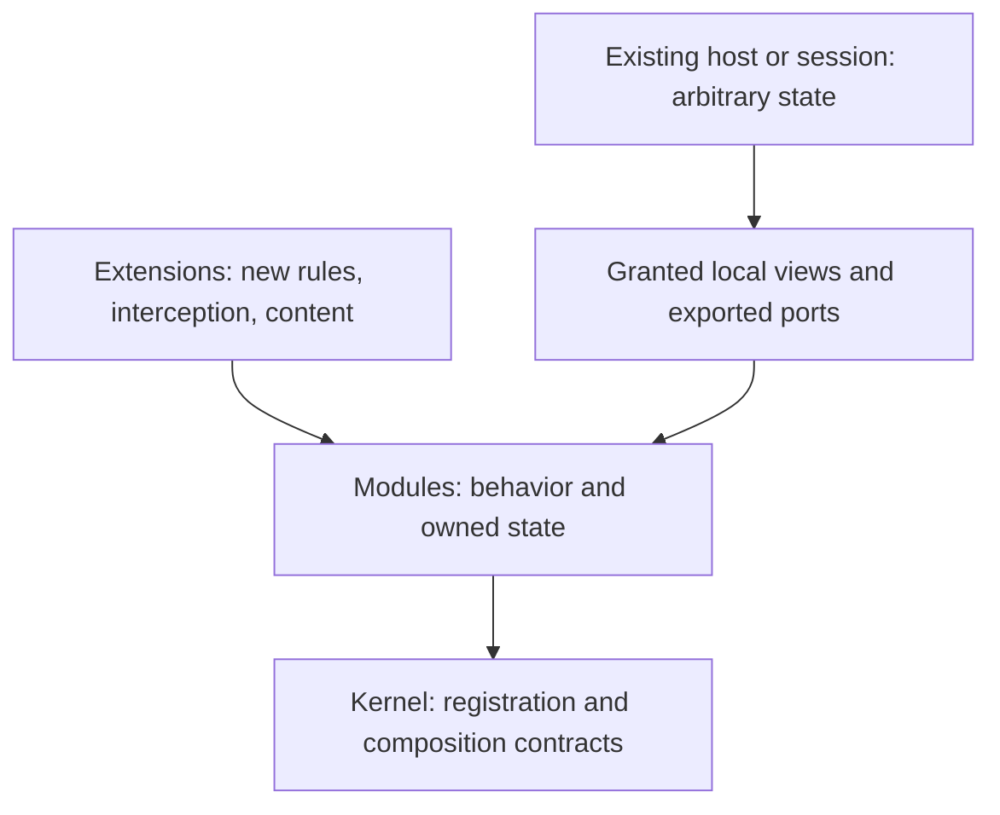

# Kernel, modules and extensions

First formal design, requested after stopping the wand implementation. The executable specification is [Architecture.lean](../../NetMechanics/Architecture.lean), imported by the library root. Rust migration and an executable plugin loader have not been implemented. Existing parity evidence remains evidence for the NetHack implementation, not for this design.

## Three layers, attached to an existing host

The **kernel** manages module registration, capability contracts and extension composition. It has no required map, hero, actor, inventory, clock, RNG, NetHack command enum or global game rules.

A **module** owns domain behavior and state: objects, combat, spatial queries, an explosion model, or something unrelated to NetHack. It exports versioned capabilities and named extension points. Modules can cooperate through those capabilities; they do not import a concrete `SimulationWorld` or retrieve arbitrary host state.

An **extension** attaches to an exported point on an installed module. It can change an algorithm, intercept a command or introduce behavior; it is not restricted to changing constants. A package needing a new domain can also install a module through the same registration protocol. The existing host's state is retained. Extension state initialization and migrations are explicit operations, not silent session reconstruction.

The host shell can hold additional namespaced module-owned state beside an existing game state. This provides new extension state without adding a field for every addon to `SimulationWorld`. A port grants access to one owned resource/operation, not a universal dynamic-resource lookup. The Lean attachment theorem covers descriptor registration; allocating new state is a separate initialization transition that must preserve preexisting resources.

Here, a world is one possible host. NetHack uses maps, actors, equipment and shop accounts. A device/explosion simulation may use scalar or field state without actors, inventory or a map. The kernel does not create empty versions of absent game systems.

## Access and behavior

The host lends a module a bounded mutable view and a separate read-only context. A module receives neither the host object nor a generic `get_any_resource` service. Shared storage has one owner; a wand module does not create a second copy of item identity, charges or debt. Cross-domain mutation uses a declared composite view or exported operation with a clear commit boundary.

The Lean model represents a mutable view by `Scope`: reads and writes satisfy lens laws, and writes preserve an explicitly selected frame of unrelated state. The adapter must actually provide these laws. A trivial frame protects nothing; naming a view does not prove isolation. Read-only observations enter the rule through `Context`.

Rules are **relations**, rather than one fixed kernel function. The model admits several outcomes for the same state and command, and extensions can transform rules. `Functional` is an optional profile property. Vanilla NetHack's seed/RNG/order contract remains a profile requirement; other modules can declare external input or entropy. Registration order is explicit so hook precedence is unambiguous; it does not freeze gameplay.

Safety and gameplay policy are distinct. `SafeExtension` requires preservation of a chosen local invariant, and `extensions_preserve_invariant` proves preservation through a list of extensions under that assumption. An extension can change damage rules while still being required to respect storage identity and accounting invariants. The theorem does not certify an arbitrary plugin binary.

## Attaching to a running session

1. Resolve module IDs, versions, capability requirements, provider conflicts and declared extension points. Dependencies must already be installed; cyclic/self dependencies cannot be introduced by successive valid registrations from an empty kernel.
2. Bind actual module code to its manifest and granted typed ports. Validate package identity and compatibility before activation. This binding is a loader obligation, not currently a Lean theorem.
3. Prepare new module-owned state and any explicit migration. Existing resources are retained; incompatible extensions are refused or require a declared migration.
4. Publish registration at a quiescent operation boundary. Pending commands continue under their pinned pipeline until completed or explicitly migrated. No handler is swapped halfway through an operation.
5. Record the active modules, extension order, package identities and relevant external-input/RNG policy for persistence and replay.

The current Lean model covers registration, not package execution, initialization, unloading, upgrades or rollback of migration. It rejects busy registration, duplicate IDs, missing dependencies/capabilities, conflicting capability providers and unexported extension points. Production must enforce the boundary flag and validate persisted manifests; callers cannot merely claim to be at a boundary. Safe unloading must also reject active dependents, owned live references and pending continuations.

## What is already machine checked

| Property | Evidence |
|---|---|
| Successful module and extension attachment retain existing domain state | `attach_module_preserves_state`, `attach_extension_preserves_state` |
| A module operation preserves the granted frame and kernel registration | `module_run_preserves_frame`, `module_run_preserves_kernel` |
| Invariant-preserving extensions compose | `extensions_preserve_invariant` |
| Extensions change behavior in an already populated, entity-free session | Examples: device state 41 becomes 42; after attaching `boost`, it becomes 43; unrelated flag survives |
| Determinism is optional | `coin_not_functional` |
| Invalid registrations are rejected | Checked examples for busy, duplicate, missing dependency/capability, provider collision and unknown extension point |

These are architecture properties over an abstract model. They do not establish NetHack parity, physics correctness, sandboxing, fairness, termination or correspondence with Rust.

The next [workflow and continuation contract](2026-10-08-workflow-contract.md) now formalizes module-owned phase transitions, committed prefixes, pinned pipelines, resume tickets and an assumed checkpoint-codec law. The domain-specific requirements below remain separate from those generic protocol proofs.

## Check against extracted NetHack facts

The [53-family registry](../parity/obligations/2026-10-07-remaining-parity-scope.json) supplies the complete family routing. The [architecture mapping](../parity/obligations/2026-10-08-architecture-family-map.json) retains each family's selected branches and identifies the required module collaborations. This is a structural adequacy audit, not a fresh re-audit or closure of all 543 historical behavior rows.

Concrete stress cases use the extracted [D1](../superpowers/specs/2026-10-04-fidelity-d1-c-reference.md), [D2](../superpowers/specs/2026-10-04-fidelity-d2-c-reference.md), [D3](../superpowers/specs/2026-10-05-fidelity-d3-c-reference.md), [wand charge contract](../parity/obligations/2026-10-07-p11a-charge-contract/contract.md) and [wand lifetime contract](../parity/obligations/2026-10-08-p11a-lifetime-contract/README.md). Historical D1–D3 Rust-gap statements are not assumed current. The accepted contracts pin their C source authority separately.

| Extracted requirement | Consequence for architecture | Current formal coverage |
|---|---|---|
| Wand selection, unpaid check, charge draw, backfire/effect, cleanup and time have a specific order; cancelling direction may retain spent charge/time | A gameplay workflow owns explicit phases and outcomes. A generic unordered callback bus is insufficient | Module-owned phase graphs and ordered committed traces; full NetHack workflows still need domain models |
| Negative charge, zero wrest and positive charge have different prescribed RNG branches; later exercise may draw again | RNG is an explicit capability. NetHack keeps its existing ordered stream; splitting by module would change vanilla results | Recorded-input service with exact endpoint/issued-key checks; the vanilla draw stream remains a runtime/profile obligation |
| `current_wand` can be explicitly cleared while part of a stack remains | Effects return survivor/cleared identities, not a fresh arena-existence guess | Owned continuation tickets and saved phases; object-generation/survivor rules still need a domain model |
| Whole disposal cleans equipment/timers and retains consumed shop liability, unlike decrement-one consumption | Object lifetime coordinates storage, references and accounting through one preflight/commit operation | Reviewed versioned atomic prepare/commit and retirement/debt witness; production validators and ports remain to migrate |
| Effective attributes/properties include worn gear, timed conditions, form, skills and provenance | Read-only queries compose multiple providers; caches need explicit invalidation | Separate `Context`; provenance and cache laws are domain obligations |
| Monster attacks include multi-attack, passive, engulf and death/lifesave contexts | Combat workflows need outcomes and controlled nested calls; independent damage callbacks are insufficient | Abstract handlers can express them; reentrancy and stop/death policy still need contracts |
| Timers and cached/off-level objects survive level changes and save/load | Time, identity and residency are separate services; callbacks retain named owners and resumable state | Pinned timer admission/replay, dependency-aware retention and restore ordering; actual residency/tie policies and codecs remain unproved |
| Character role initialization, malign and kill alignment adjustments use different contexts | Configuration, initialization and kill-credit policy are separate modules/extensions | No compulsory hero/role in kernel; typed context can carry required facts |
| Special maps/quests are content programs, not just item-table overrides | Content loaders consume declared generation/topology capabilities | Registrations are expressible; no script interpreter is implemented |
| Old saves, ruleset identity, native continuation and frontend cancellation remain observable contracts | Persistence records module schemas/pipeline identity; adapters preserve wire formats during migration | Attachment/pin preservation and conditional codec/migration admission; actual serialization and supported legacy migrations remain unproved |

**Finding: the three layers are necessary but insufficient by themselves.** The design therefore needs seven explicit contracts before broad Rust migration: capability authority and code binding; ordered workflows and committed/refused/suspended outcomes; cross-owner mutation; RNG/external-input policy; timers and resumable continuations; persistence/version migration; and attachment/replacement lifecycle. The kernel owns generic registration/dispatch guarantees. NetHack-specific formulas, scheduler policy and effect ordering remain module/profile behavior.

The generic model must not promise that every cancellation rolls back state or RNG: the wand direction-cancel branch is a concrete counterexample. Likewise, module installation order is not a substitute for the source order inside an action.

## Migration in bounded steps

1. Complete these architecture contracts in Lean, with counterexamples and explicit assumptions. Keep the entity-free and live-extension examples as acceptance cases.
2. Prototype a minimal host and extension backend without a dependency on NetHack state. Verify runtime attachment changes behavior while preserving existing state. Choose the loader/backend in that bounded prototype, rather than adding a framework fleet now.
3. Adapt the existing NetHack session to capability views and owned services. Keep its public API and save representation as compatibility adapters; do not recreate the session to attach a module.
4. Extract one complete wand workflow, its item-lifetime operation and accounting ports together. Pure mechanics already in `nethacked-core` can be retained. Moving `impl SimulationWorld` to another file alone does not satisfy this step.
5. Migrate the remaining family groups through the same boundaries while preserving tests and source evidence. Existing formal models remain NetHack-specific domain modules; they are not renamed into the generic kernel.

The interrupted `world.rs` patch and its tests remain uncommitted and unaccepted. They can supply fixtures for migration, but their earlier two-file allowlist is not the architectural boundary for the new work. No full rewrite, parity completion percentage or new golden rebaseline is authorized by this document.

The [authority/transaction contract](2026-10-08-authority-transaction-contract.md) now supplies the separately reviewed formal S1/S3 protocol. The [execution goal](2026-10-08-microkernel-goal.md) tracks runtime and migration acceptance; the [migration inventory](../parity/obligations/2026-10-08-microkernel-migration-inventory.json) records current universal-world coupling. The interrupted wand draft is preserved in an external hash-bound archive and removed from active architecture inputs.

The [optional service contracts](2026-10-08-service-contracts.md) specify input/RNG recording, pinned timer admission, validated restoration and dependency-aware lifecycle guards. Their policy/codec assumptions remain runtime acceptance work; they do not close the behavior-parity backlog.
